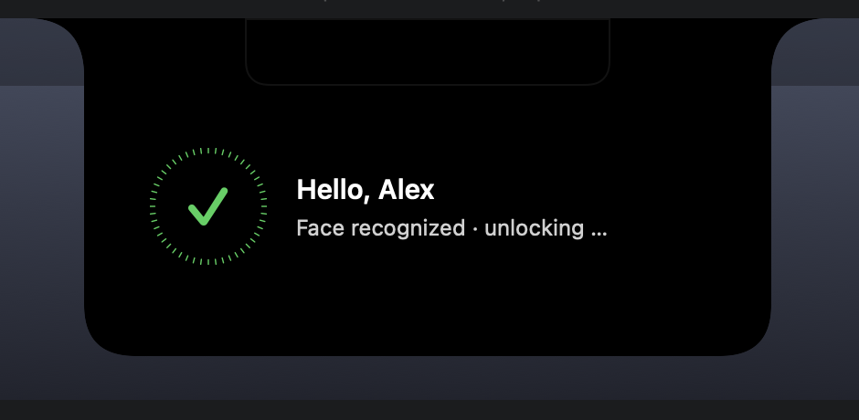
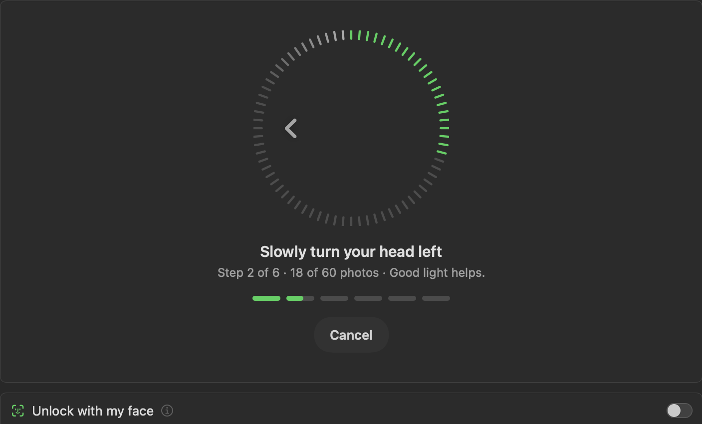
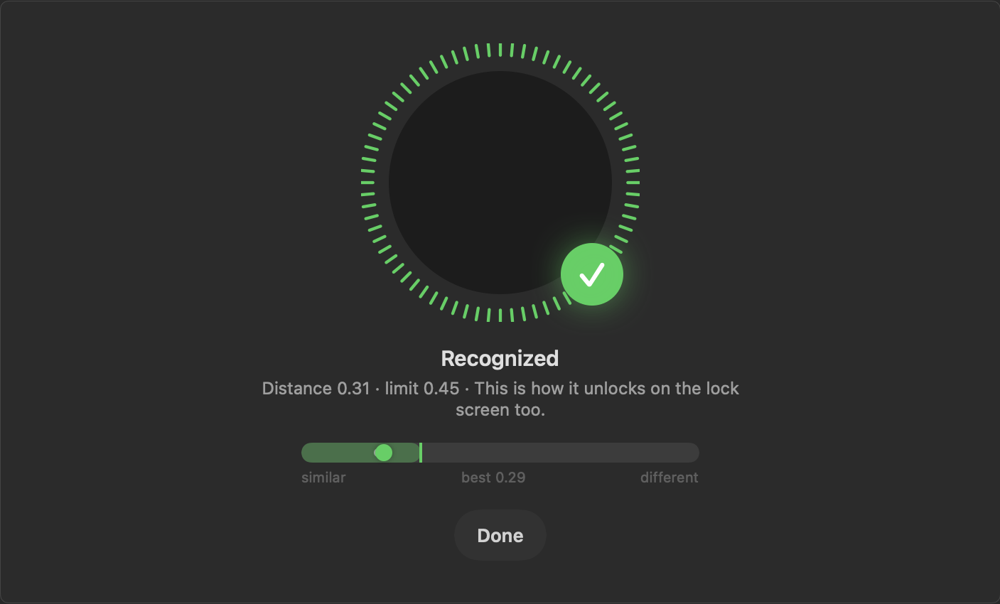
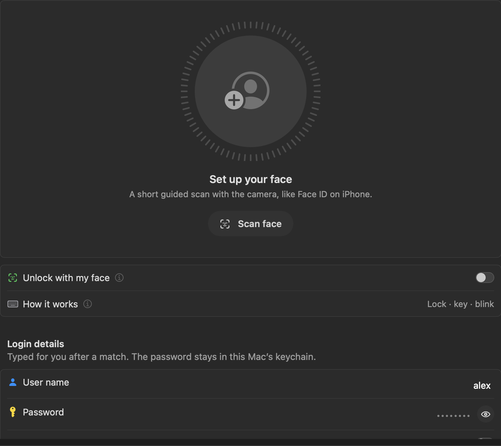

<div align="center">


# Face Unlock for Droppy

**Unlock your Mac with your face, right from the notch.**

A Face ID style unlock for macOS, built as a [Droppy](https://getdroppy.app) droplet.
Lock your Mac, press a key, look at the camera, blink. Done.

[](CHANGELOG.md)
[](#requirements)
[](https://getdroppy.app)
[](https://getdroppy.app/docs/droppykit)
[](Package.swift)
[](LICENSE)

</div>

---

<p align="center">
  
</p>

## Features

- 🔓 **Unlock with your face**: recognizes you on the lock screen and types your login password for you
- 🧭 **Guided face scan**: 60 photos from six angles, with a Face ID style tick ring, direction arrows and step progress
- 👁️ **Blink check**: a match only counts after you blink, so a still photo is not enough
- ⌨️ **Camera only on request**: the camera stays off until you press a key or click on the lock screen
- 🏝️ **Lives in the notch**: a live scan strip that grows into a "Hello" card when it recognizes you
- 🔒 **Lock screen status**: a countdown ring and clear status on Droppy's lock screen row
- 🎯 **Self calibrating**: sets its match limit from your own scan, with a live distance gauge to fine tune it
- 🔑 **Keychain storage**: your password never leaves this Mac's Keychain, your face data never leaves the Mac
- 👤 **User name support**: optionally types your user name first, for "Name and password" login windows
- 🌍 **Six languages**: English, Deutsch, Français, Español, Italiano, Nederlands

## Screenshots

| Guided scan | Test your match |
| :---: | :---: |
|  |  |

<p align="center">
  <br>
  <sub>The scan strip in the notch while it looks for you</sub>
</p>

<p align="center">
  <br>
  <sub>Status on Droppy's lock screen, as a line or a ring</sub>
</p>

<details>
<summary><b>Full settings page</b></summary>
<br>
<p align="center"></p>
</details>

## How it works

```
 Lock (⌃⌘Q)  ─▶  press any key  ─▶  camera looks for you (30 s)  ─▶  blink  ─▶  unlocked
```

1. **Lock** your Mac. Droppy's lock screen shows *Press a key to unlock*.
2. **Press a key** or click. Only now does the camera turn on.
3. **Look at the camera.** Face Unlock compares your face with your saved scan.
4. **Blink once.** On a match, the notch shows *Hello* and your password is typed for you.

If it does not recognize you within 30 seconds, the camera turns off again and waits for the next key press. You can always type your password as usual.

## Requirements

- A Mac with a camera, running **macOS 14 Sonoma** or later
- **[Droppy](https://getdroppy.app) 15.3** or later

## Installation

1. Download **`FaceUnlock.droplet.zip`** from the [latest release](https://github.com/janluca22467/droppy-face-unlock/releases/latest) and unzip it.
2. In Droppy, open **Settings › Store › Local droplets** and drop **`FaceUnlock.droplet`** onto it.
3. Approve the droplet when Droppy asks. Droppy asks again each time it opens, because the build is not signed by the Droppy Store.

> [!TIP]
> To try it first without touching your Droppy setup, use the free [Droppy Playground](https://getdroppy.app/download/playground) and copy the bundle to
> `~/Library/Application Support/Droppy Playground/Droplets/face-unlock/`.

## Setup

Open **Face Unlock** in Droppy's settings and work from top to bottom:

1. **Scan your face**: follow the arrows. Good, even light helps.
2. **Test**: blink once and check that it says *Recognized*. Use the gauge to tune the limit if needed.
3. **Login details**: enter your Mac password and save. Turn on *Type user name first* only if your login window asks for a name.
4. **Permissions**: allow the three permissions below for **Droppy**.
5. Turn on **Unlock with my face** and lock your Mac to try it.

| Permission | Why it is needed |
| --- | --- |
| 📷 Camera | To see your face during the scan |
| ⌨️ Accessibility | To type your password into the lock screen |
| 🖐️ Input Monitoring | To start the scan when you press a key on the lock screen. Without it, the scan starts only when the display wakes |

## Security and privacy

> [!WARNING]
> Face Unlock uses the regular camera and Apple's Vision framework, **not** Face ID's depth sensing hardware.
> It is a convenience feature, not strong security. Someone who looks very similar to you, or a good video, may get through.
> Do not use it on a Mac that holds data you need to protect against people with physical access.

- Your **password** is stored in the macOS Keychain on this Mac only, and is never synced, logged or sent anywhere.
- Your **face data** is a set of numeric feature vectors in Droppy's private droplet folder, with file protection, and never leaves the Mac.
- Face Unlock makes **no network connections**.
- The camera only runs while you scan in settings, or for up to 30 seconds after you press a key on the lock screen.
- A **blink** is required before every unlock.
- Remove everything at any time: *Saved face › Remove* and *Login details › Delete*.

## Languages

Face Unlock follows the language Droppy runs in:

🇬🇧 English · 🇩🇪 Deutsch · 🇫🇷 Français · 🇪🇸 Español · 🇮🇹 Italiano · 🇳🇱 Nederlands

## Troubleshooting

| Problem | Fix |
| --- | --- |
| Nothing happens on the lock screen | Check *Last lock* in settings. It says what was missing |
| *Face Unlock: Accessibility missing* | Allow Accessibility for Droppy in System Settings › Privacy & Security |
| A key press does not start the scan | Allow Input Monitoring for Droppy, or wake the display instead |
| It does not recognize you | Scan again in good light, then use *Test* and *Set limit* |
| It types into the wrong field | Turn *Type user name first* off unless your login window asks for a name |

## Build from source

Face Unlock is a Swift package built with [DroppyKit](https://getdroppy.app/docs/droppykit).

```bash
git clone https://gitlab.com/droppyformac1/droppykit.git
export PATH="$PWD/droppykit/Scripts:$PATH"

git clone https://github.com/janluca22467/droppy-face-unlock.git
cd droppy-face-unlock
droppykit build      # writes .build/FaceUnlock.droplet
droppykit validate
droppykit run        # opens the DroppyKit harness
```

<details>
<summary><b>Project layout</b></summary>

```
droplet.json                     manifest: id, version, capabilities, surfaces
Package.swift                    the droplet library and its harness
Sources/FaceUnlock/
  FaceUnlockDroplet.swift        lock screen flow, HUD, lock screen row, state
  FaceRecognizer.swift           camera, Vision, face template, guided scan
  FaceScanViews.swift            tick ring, scan hero, notch strip and card
  FaceUnlockSettings.swift       settings page
  WakeTrigger.swift              key press and click detection while locked
  KeyTyper.swift                 types the credentials
  PasswordStore.swift            Keychain storage
  Localization.swift             the six languages
FaceUnlock.icon/                 app icon
```
</details>

## License

[MIT](LICENSE) © [Jan-Luca](https://github.com/janluca22467)

Face Unlock is an independent project and is not affiliated with Apple or Droppy. Face ID is a trademark of Apple Inc.
